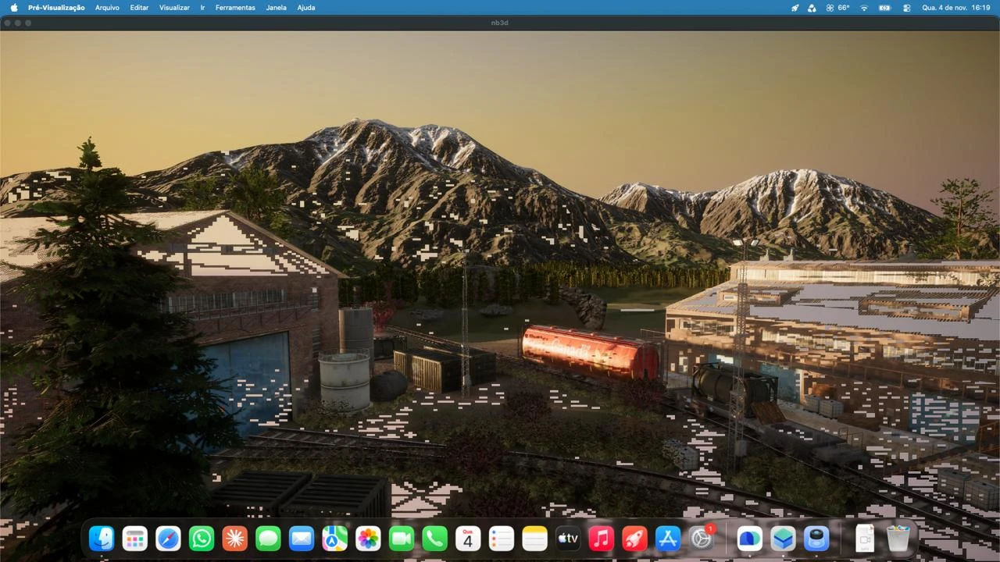
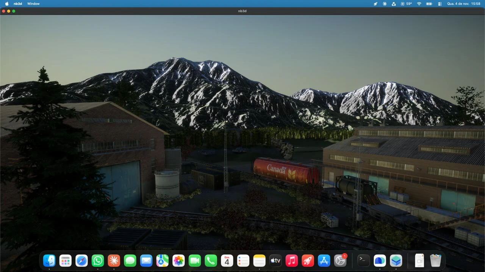

# Stencil view fix (WhateverXe Graphics Metal driver)

Workaround for white/black blocks in 3D scenes (lit and reflective areas) on the WhateverXe Graphics stack, found on a
Dell G15 5530 (i5-13450HX, UHD `8086:A78B` rev 4, ADL-S/RPL-HX GT1, 16 EU), macOS Tahoe 26.7.1, WhateverXe 0.7.0
(+ the fixes from issue #31), WhateverXe Graphics 0.4.0. The same blocks were also present with a NootedGreen-based
stack, which uses the same Apple TGL Metal driver.

| before | after |
|---|---|
|  |  |

(Novabench 3D test, `nb3d`, Unity 6.)

## The bug

1. Render stencil into a `MTLPixelFormatDepth32Float_Stencil8` texture (render target + shader read +
   `MTLTextureUsagePixelFormatView`, private storage).
2. Create `newTextureViewWithPixelFormat:MTLPixelFormatX32_Stencil8` and read it as `texture2d<uint>` in a compute or
   fragment shader.

Minimal case: one 300x200 draw with stencil reference 3 into a cleared 1920x1080 texture. Through the view, only
25 624 of the 60 000 pixels read 3, and about 1 096 pixels outside the rectangle are non-zero (wrong 16x16 blocks).
The stored stencil is correct:

| read path | result |
|---|---|
| stencil test (`Equal 3`) in a render pass | 60 000 / 60 000, 0 outside |
| blit to buffer (`MTLBlitOptionStencilFromDepthStencil`) | 60 000 / 60 000, 0 outside |
| `X32_Stencil8` view, compute or fragment | **25 624 / 60 000, 1 096 outside** |
| same, after an empty Load/Store pass | **wrong (same numbers)** |
| `X32_Stencil8` view of a **blit copy** (`copyFromTexture:toTexture:`) | 60 000 / 60 000, 0 outside |
| `allowGPUOptimizedContents = NO` on the texture | **still wrong** |

Depth is always exact. So the view seems to describe the stencil plane of a render-written depth-stencil surface
with the wrong layout (tiling or compression state); a blit reads it correctly and writes a copy whose view is correct.
Unity 6 creates `Depth32Float_Stencil8 -> X32_Stencil8` views (1920x1080 and 960x540 in `nb3d`) and samples them in
its lighting passes, which produces the blocks.

## The workaround

`stencilfix.mm` builds an `impostor.dylib` that goes into `AppleIntelTGLGraphicsMTLDriver.bundle/Contents/MacOS`
(the driver loads `@loader_path/impostor.dylib` in every Metal process). The original is renamed
`impostor-real.dylib` and fully re-exported. In each app process it swizzles `MTLIGAccelTexture`,
`MTLIGAccelCommandBuffer` and `MTLIGAccelRenderCommandEncoder`: a stencil view of a depth-stencil texture becomes a
view of a shadow copy, and every render pass that writes that texture is followed by a blit into the shadow.
System processes (`/System`, `/usr`, so WindowServer) are left alone. In `nb3d` this removes all the blocks.

```bash
bash build.sh                 # on macOS with the Command Line Tools
sudo bash install.sh          # install or update; relaunch the app
bash install.sh log           # what it did
sudo bash install.sh remove   # restore the original
```

This is a workaround, not a fix: the real fix belongs in the driver (the surface state used for stencil views of
depth-stencil textures on this hardware, or a stencil resolve before sampling).
